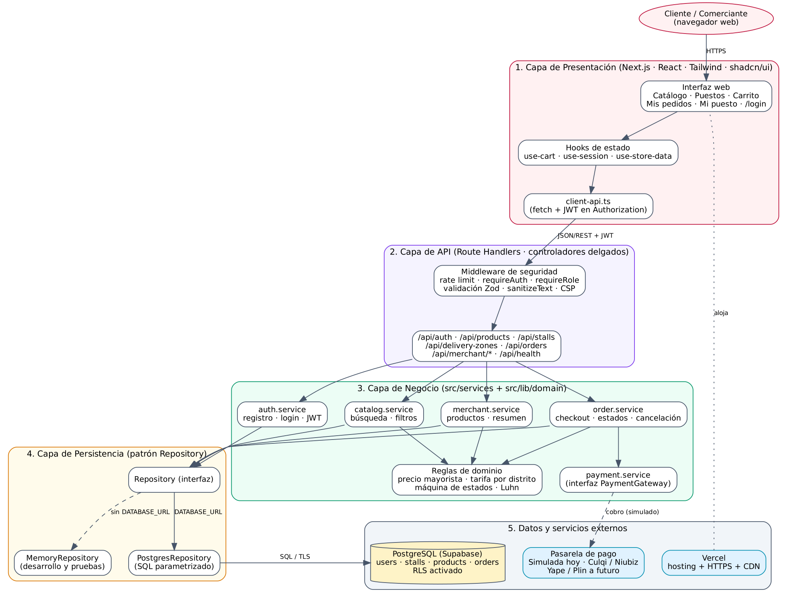
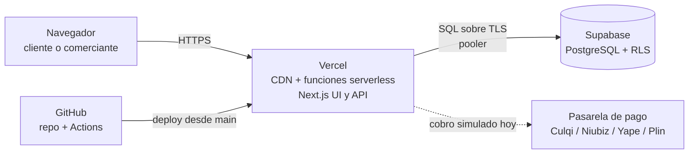

# Arquitectura – Flores de Acho

## 1. Contexto y requisitos que la guían

El Mercado de Flores de Acho vende casi todo en persona y su demanda se dispara en San Valentín, Día de la Madre y
Todos los Santos. La arquitectura responde a estas necesidades del caso:

| Necesidad del caso | Decisión arquitectónica |
|---|---|
| Demanda muy variable (picos por fecha) | Despliegue serverless en la nube pública (Vercel) que escala por demanda |
| Cientos de comerciantes sin conocimientos técnicos | Panel web simple con roles; sin instalación |
| Compras de varios puestos en un solo carrito | Pedido por puesto con stock reservado de forma atómica |
| Pagos digitales (Yape, Plin, tarjeta) | Interfaz `PaymentGateway` desacoplada; hoy simulada |
| Se manejan datos personales y de pago | Seguridad por capas, sin guardar datos de tarjeta |
| Equipo pequeño y plazo corto | Monolito modular en capas (un solo despliegue) |

## 2. Arquitectura lógica

Fuente editable: [`img/arquitectura-logica.dot`](img/arquitectura-logica.dot) (Graphviz) y [`img/arquitectura-logica.svg`](img/arquitectura-logica.svg).

Cinco capas, cada una depende solo de la inmediata inferior:

1. **Presentación (frontend):** Next.js + React. Pantallas de catálogo, puestos, carrito, pedidos, panel del comerciante y `/login`. Los hooks guardan el carrito y la sesión; `client-api.ts` llama a la API con el JWT.
2. **API:** Route Handlers de Next.js como controladores delgados. Cada uno aplica rate limit, autenticación/rol, valida con Zod y delega en un servicio.
3. **Negocio:** `src/services` (auth, catálogo, pedidos, pagos, comerciante) y reglas puras en `src/lib/domain` (precio mayorista, tarifa por distrito, máquina de estados del pedido, Luhn).
4. **Persistencia:** patrón Repository. Una interfaz con dos implementaciones: memoria (demo y pruebas) y PostgreSQL (SQL parametrizado).
5. **Datos y servicios externos:** PostgreSQL en Supabase, pasarela de pagos (simulada hoy) y Vercel como hosting con HTTPS y CDN.

### Comunicación entre componentes

| Origen → destino | Protocolo y formato | Autenticación |
|---|---|---|
| Navegador → Vercel | HTTPS (TLS) | – |
| Frontend → API | REST sobre HTTPS, JSON | `Authorization: Bearer <JWT>` (2 h) en rutas protegidas |
| API → servicios | Llamada de función en el mismo proceso | – |
| Servicios → Repository | Interfaz TypeScript | – |
| PostgresRepository → Supabase | SQL parametrizado sobre TLS (pooler) | `DATABASE_URL` en variable de entorno |
| `order.service` → pasarela | Interfaz `PaymentGateway.charge()` | Credenciales del proveedor (futuro) en variables de entorno |

### Especificación de componentes

| Componente | Función | Interfaz | Datos | Calidad |
|---|---|---|---|---|
| Interfaz web | Mostrar catálogo, carrito, pedidos y panel | Páginas React; llamadas `client-api.ts` | Estado local (carrito, sesión en `localStorage`) | Usabilidad, responsive, accesible (Radix) |
| Middleware de seguridad (`http.ts`) | Limitar, autenticar, autorizar y manejar errores | `enforceRateLimit`, `requireAuth`, `requireRole`, `handle` | Contadores en memoria por IP | Seguridad; errores sin trazas internas |
| `auth.service` | Registro, login y emisión de JWT | `registerUser`, `loginUser` | Usuarios (hash scrypt) | Seguridad; no revela si el correo existe |
| `catalog.service` | Buscar y filtrar productos, listar puestos y zonas | `searchProducts`, `getProductDetail`, `listStalls`, `listDeliveryZones` | Productos y puestos | Rendimiento; búsqueda sin distinguir tildes |
| `order.service` | Checkout, estados y cancelación | `checkout`, `listMyOrders`, `listStallOrders`, `cancelOrder`, `advanceOrder` | Pedidos y stock | Consistencia: stock atómico y compensación si falla el pago |
| `payment.service` | Cobrar a través de una pasarela | `PaymentGateway.charge`; `SimulatedGateway` | Solo método, estado y referencia | Intercambiable; no guarda datos de tarjeta |
| `merchant.service` | Publicar y editar productos, resumen de ventas | `addProduct`, `updateProduct`, `getMyStall` | Productos y pedidos del puesto | Autorización por propietario (403) |
| Repository | Aislar el acceso a datos | Interfaz `Repository` (incl. `adjustStock`) | Usuarios, puestos, productos, pedidos | Testeable; SQL parametrizado |
| PostgreSQL | Persistir | SQL | Tablas con CHECK, índices y RLS | Integridad; respaldos del proveedor |

## 3. Vista por capas de SI/TI y vista física

| Capa | Contenido en el caso |
|---|---|
| Negocio | Venta de flores por puesto, precio mayorista, delivery por distrito, picos por ocasión |
| Datos | Usuarios, puestos, productos, pedidos (PostgreSQL) |
| Aplicaciones | Web Flores de Acho (UI + API + servicios) |
| Tecnología | Vercel (serverless), Supabase (PostgreSQL), GitHub Actions |

La vista **lógica** muestra responsabilidades y dependencias; la **física** muestra dónde corre cada pieza. Aquí el
frontend y la API van en el mismo despliegue de Vercel, y solo la base de datos y la pasarela son externas.

## 4. Decisiones de arquitectura (ADR)

| Aspecto | Resolución | Alternativas | Argumento | Implicaciones |
|---|---|---|---|---|
| Estilo | Monolito modular en capas | Microservicios | Equipo pequeño y plazo corto; los límites por capa permiten separar después | Un solo despliegue; escala en conjunto |
| Hosting | Nube pública serverless (Vercel) | Servidor propio, VPS | Demanda con picos fuertes; no se paga capacidad ociosa | Dependencia del proveedor; instancias sin estado |
| Base de datos | PostgreSQL (Supabase) | MongoDB, SQLite | Datos relacionales (pedido→ítems→producto) y restricciones de integridad | Requiere pooler en serverless |
| Acceso a datos | Patrón Repository | SQL directo en servicios | Permite pruebas rápidas en memoria y cambiar de base | Dos implementaciones que mantener |
| Pagos | Interfaz `PaymentGateway`, simulada | Integrar Culqi desde el inicio | No hay credenciales comerciales en el curso; el contrato queda listo | No mueve dinero real |
| Autenticación | JWT HS256 propio con roles | Sesiones con cookie, NextAuth | API sin estado, compatible con serverless; rol en el token | Sin revocación antes de los 2 h; mitigado con expiración corta |
| Pedidos | Un pedido por puesto | Un pedido global | Cada comerciante gestiona solo lo suyo | El cliente ve varios pedidos por compra |
| Stock | Descuento atómico y compensación | Descontar al pagar | Evita vender dos veces el último ramo | Hay que reponer si el pago falla |

## 5. Seguridad transversal

| Riesgo | Control |
|---|---|
| Inyección / XSS | Zod en toda entrada, `sanitizeText`, escape de React, CSP, SQL parametrizado |
| Autenticación débil | scrypt con sal, JWT con expiración, rechazo de `alg: none`, `JWT_SECRET` ≥ 32 caracteres obligatorio en producción |
| Acceso indebido | `requireRole` (403) y comprobación de propietario en puestos, productos y pedidos |
| Fuerza bruta y abuso | Rate limit por IP (login 10/min, checkout 10/min) → 429 |
| Datos de pago | No se almacenan número, CVV ni vencimiento; solo método, estado y referencia |
| Fuga de secretos | `.env*` fuera de git, GitHub Secrets, Gitleaks en CI |
| Dependencias vulnerables | `npm audit`, Dependabot, `overrides` para fijar versiones parcheadas |

## 6. DevSecOps por fase (shift-left)

| Fase | Actividad y herramienta | Seguridad en la fase | Justificación para el caso |
|---|---|---|---|
| **Plan** | Jira: épicas, historias con criterios Dado/Cuando/Entonces, sprints | Historias de seguridad (HU-22, 23, 24); modelado de amenazas de pagos y datos personales | Se manejan datos de clientes y pagos; la seguridad se planifica desde el inicio |
| **Code** | Git con ramas `main`/`test` y PR; TypeScript estricto; ESLint + `eslint-plugin-security` | Revisión en PR; SAST local; `.gitignore` y `.env.example` para no subir secretos | Detectar el problema cuando es más barato corregirlo |
| **Build** | GitHub Actions: lint, typecheck, `npm ci`, build | SAST (ESLint, CodeQL `security-extended`); `npm audit` (SCA); Gitleaks | Bloquea código inseguro antes de llegar a producción |
| **Test** | Vitest: 56 pruebas con cobertura ~91 % | Pruebas de seguridad: JWT, roles (401/403), validación, rate limit, XSS, autorización por propietario | Los pedidos y el stock no pueden fallar en fechas pico |
| **Release** | PR `test → main`; checks obligatorios | Rama `main` protegida; solo se une con pipeline en verde | Evita publicar sin revisión |
| **Deploy** | Job `deploy` a Vercel solo desde `main` | Secretos en GitHub/Vercel; HTTPS; cabeceras de seguridad | Entrega automática y repetible |
| **Operate** | Vercel serverless; Supabase gestionado | Mínimo privilegio; RLS; `JWT_SECRET` y `DATABASE_URL` por entorno | Escala en San Valentín sin administrar servidores |
| **Monitor** | `GET /api/health`; logs JSON estructurados; Dependabot y alertas de CodeQL | Registro de eventos de seguridad (login fallido, 403, 429) | Detectar caídas y abuso en las fechas de más ventas |

## 7. Trazabilidad con el backlog

| Épica | Componentes principales |
|---|---|
| E1 Catálogo | `catalog.service`, `/api/products`, `/api/stalls`, vistas Catálogo y Puestos |
| E2 Carrito y pedidos | `order.service`, `domain/pricing`, `/api/orders`, `use-cart` |
| E3 Pagos | `payment.service`, `domain/payment` (Luhn) |
| E4 Recojo y delivery | `data/zones`, `deliveryFeeFor`, `domain/orderFlow` |
| E5 Panel del comerciante | `merchant.service`, `/api/merchant/*`, `merchant-panel` |
| E6 Cuentas y seguridad | `auth.service`, `lib/auth`, `lib/http`, `lib/validation`, `next.config.mjs` |
