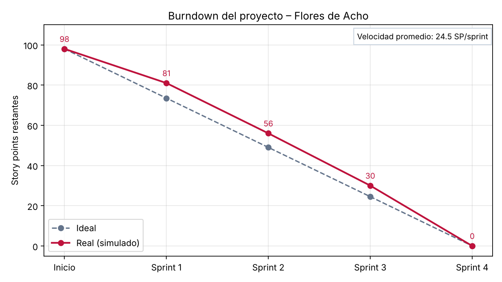
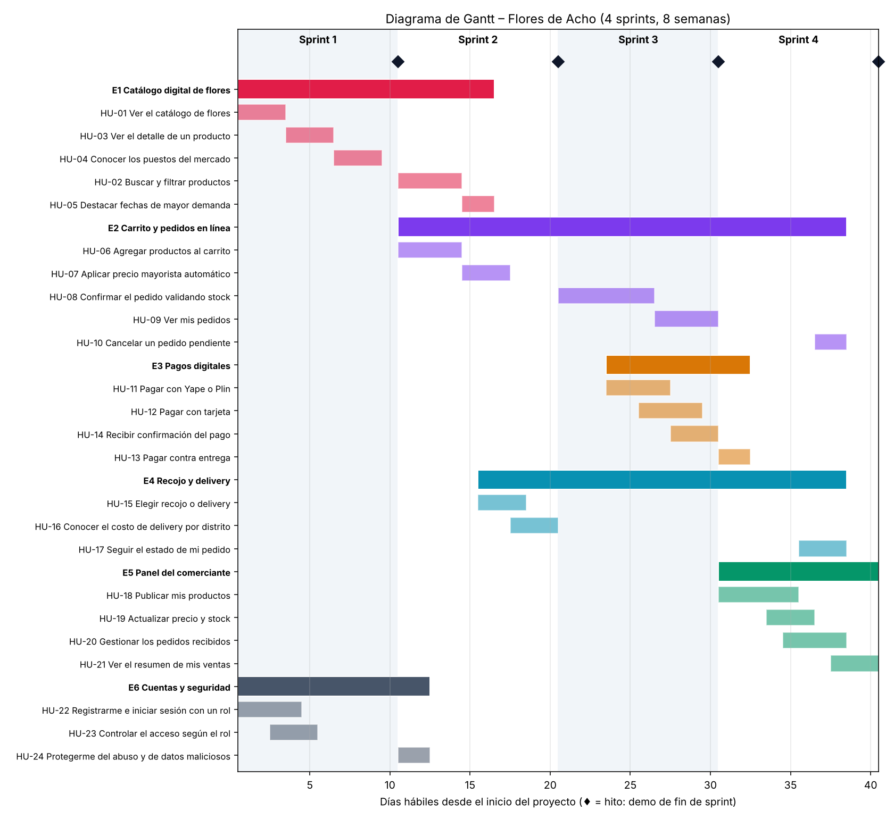

# Planificación de 4 sprints – Flores de Acho

> **Simulación académica.** Las fechas se expresan como semanas y días hábiles relativos al inicio del proyecto; al crear los sprints en Jira se usan las fechas reales. Los valores "reales" del burndown son una simulación coherente con el plan (hay arrastre de historias entre sprints).

Duración: **4 sprints de 2 semanas (10 días hábiles)**. Backlog: 98 SP. Velocidad promedio planificada: **24.5 SP por sprint**.

## Sprint 1 · Base segura y catálogo público

- **Duración:** semanas 1–2 (días hábiles 1–10)
- **Sprint goal:** Que cualquier persona vea el catálogo y que existan cuentas con roles y controles de seguridad básicos.
- **Story points planificados:** 20

| Historia | Título | Épica | SP | MoSCoW |
|---|---|---|---|---|
| HU-01 | Ver el catálogo de flores | E1 | 3 | Must |
| HU-03 | Ver el detalle de un producto | E1 | 3 | Must |
| HU-04 | Conocer los puestos del mercado | E1 | 3 | Should |
| HU-22 | Registrarme e iniciar sesión con un rol | E6 | 5 | Must |
| HU-23 | Controlar el acceso según el rol | E6 | 3 | Must |
| HU-24 | Protegerme del abuso y de datos maliciosos | E6 | 3 | Should |

## Sprint 2 · Búsqueda y carrito

- **Duración:** semanas 3–4 (días hábiles 11–20)
- **Sprint goal:** Que el cliente encuentre productos, arme su carrito con precio mayorista y elija cómo recibir su pedido.
- **Story points planificados:** 22

| Historia | Título | Épica | SP | MoSCoW |
|---|---|---|---|---|
| HU-02 | Buscar y filtrar productos | E1 | 5 | Must |
| HU-05 | Destacar fechas de mayor demanda | E1 | 3 | Should |
| HU-06 | Agregar productos al carrito | E2 | 5 | Must |
| HU-07 | Aplicar precio mayorista automático | E2 | 3 | Must |
| HU-15 | Elegir recojo o delivery | E4 | 3 | Must |
| HU-16 | Conocer el costo de delivery por distrito | E4 | 3 | Must |

## Sprint 3 · Pedidos y pagos

- **Duración:** semanas 5–6 (días hábiles 21–30)
- **Sprint goal:** Que el cliente pueda confirmar y pagar un pedido validando el stock y consultar sus pedidos.
- **Story points planificados:** 28

| Historia | Título | Épica | SP | MoSCoW |
|---|---|---|---|---|
| HU-08 | Confirmar el pedido validando stock | E2 | 8 | Must |
| HU-09 | Ver mis pedidos | E2 | 5 | Must |
| HU-11 | Pagar con Yape o Plin | E3 | 5 | Must |
| HU-12 | Pagar con tarjeta | E3 | 5 | Should |
| HU-13 | Pagar contra entrega | E3 | 2 | Could |
| HU-14 | Recibir confirmación del pago | E3 | 3 | Could |

## Sprint 4 · Panel del comerciante y seguimiento

- **Duración:** semanas 7–8 (días hábiles 31–40)
- **Sprint goal:** Que los comerciantes publiquen, actualicen y atiendan pedidos, y que el cliente siga su entrega.
- **Story points planificados:** 28

| Historia | Título | Épica | SP | MoSCoW |
|---|---|---|---|---|
| HU-10 | Cancelar un pedido pendiente | E2 | 2 | Could |
| HU-17 | Seguir el estado de mi pedido | E4 | 5 | Should |
| HU-18 | Publicar mis productos | E5 | 8 | Must |
| HU-19 | Actualizar precio y stock | E5 | 3 | Must |
| HU-20 | Gestionar los pedidos recibidos | E5 | 5 | Must |
| HU-21 | Ver el resumen de mis ventas | E5 | 5 | Could |

## Burndown (ideal vs. real)

| Fin de… | SP restantes ideal | SP completados (real) | SP restantes real | Observación |
|---|---|---|---|---|
| Inicio | 98 | – | 98 | – |
| Sprint 1 | 73.5 | 17 | 81 | HU-24 (3 SP) pasa al Sprint 2 por falta de pruebas de límite de solicitudes. |
| Sprint 2 | 49.0 | 25 | 56 | Se completa HU-24 más lo planificado. |
| Sprint 3 | 24.5 | 26 | 30 | HU-13 (2 SP) pasa al Sprint 4 por pendiente de pruebas. |
| Sprint 4 | 0.0 | 30 | 0 | Se completa el backlog. |

**Velocidad obtenida:** 17, 25, 26, 30 SP → promedio **24.5 SP por sprint**.

## Diagrama de Gantt

Los **hitos** (♦) marcan la demo al final de cada sprint. Dependencias principales:

| Historia | Depende de |
|---|---|
| HU-23 control de roles | HU-22 cuentas |
| HU-03 detalle | HU-01 catálogo |
| HU-02 búsqueda, HU-06 carrito | HU-01 catálogo |
| HU-07 mayorista | HU-06 carrito |
| HU-16 costo de delivery | HU-15 elegir entrega |
| HU-08 confirmar pedido | HU-06, HU-07, HU-22 |
| HU-11/12/13/14 pagos, HU-09 mis pedidos | HU-08 |
| HU-18 publicar productos | HU-22, HU-23 |
| HU-19 actualizar | HU-18 |
| HU-20 gestionar pedidos, HU-17 seguimiento, HU-10 cancelar | HU-08 (y HU-18 para HU-20) |
| HU-21 resumen de ventas | HU-20 |

## Tablero Kanban

Columnas y **límites WIP** (configurar en *Tablero → Configuración → Columnas → Máx*):

| Columna | Límite WIP | Criterio de entrada |
|---|---|---|
| To Do | sin límite | Historia del sprint con criterios de aceptación listos |
| In Progress | **4** | Alguien la tomó; una persona no lleva más de 2 a la vez |
| In Review | **3** | Pull Request abierto y pipeline en verde |
| Done | sin límite | PR aprobado y mergeado, criterios de aceptación verificados |

Evidencia del flujo por sprint (instantánea a mitad del sprint, simulada):

| Sprint | To Do | In Progress | In Review | Done |
|---|---|---|---|---|
| 1 | HU-04, HU-24 | HU-23, HU-03 | HU-22 | HU-01 |
| 2 | HU-16, HU-05 | HU-07, HU-15 | HU-06 | HU-02, HU-24 |
| 3 | HU-13, HU-14 | HU-12, HU-09 | HU-11 | HU-08 |
| 4 | HU-21, HU-10 | HU-20, HU-17 | HU-19 | HU-18, HU-13 |

Al mostrar el tablero en la sustentación, deja visibles las columnas con sus límites WIP y toma una captura por sprint moviendo las tarjetas como en la tabla.
